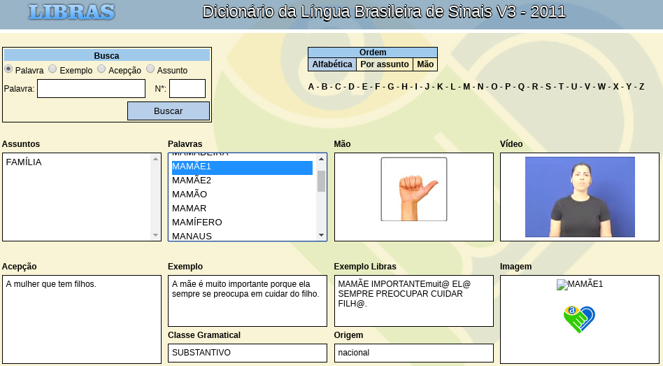

# Enunciado — Trabalho Final AMS0002

**Disciplina:** AMS0002 – Análise e Modelagem de Sistemas
**Professora:** Carla Diacui Medeiros Berkenbrock
**Data do enunciado:** 03/11/2026
**Original:** [PDF](pdf/enunciado-trabalho-final.pdf)

## 1. Tema: Expansão do Dicionário da Língua Brasileira de Sinais

Descrever como modelar a expansão do [Dicionário da Língua Brasileira de Sinais](https://www.ines.gov.br/dicionario-de-libras/),
atendendo aos seguintes requisitos:

- Permitir inserção, alteração e exclusão em todos os campos da ferramenta
- Permitir variação linguística
- Permitir a inclusão de vídeo do sinal

## 2. Etapas do trabalho

### 2.1 Engenharia de Requisitos
- Tipos de usuário
- Histórias de cada tipo de usuário
- Requisitos funcionais
- Requisitos não-funcionais e métricas para verificar se foram atingidos
- Conformidade com a WCAG
- Conformidade com a LGPD: dados sensíveis, políticas de consentimento e descarte
- Caso de uso de pelo menos 1 requisito

### 2.2 Modelagem de Software
Diagramas UML considerando o **fluxo de aprovação de um novo sinal com vídeo**:
- Diagrama de Classes
- Diagrama de Sequência
- Diagrama de Atividades

### 2.3 Projeto de Software
Proposta de adoção de um padrão arquitetural, com justificativas de que atende às necessidades do projeto
e contribui para seu sucesso a longo prazo.

## 3. Diretrizes finais
- Equipes de, no máximo, quatro acadêmicos
- Apresentação na sala 202C-32, no horário agendado
- O documento entregue no Moodle deve incluir o descritivo das atividades de cada membro

## 4. Critérios de avaliação

| Etapa | Critérios | Pontos |
|---|---|---|
| 1. Engenharia de Requisitos | Usuários e histórias; RF e RNF com métricas; WCAG e LGPD; caso de uso estruturado | 3,0 |
| 2. Modelagem de Software | Diagramas de Classes, Sequência e Atividades; fluxo de aprovação de novo sinal com vídeo | 2,0 |
| 3. Projeto de Software | Padrão arquitetural fundamentado; justificativas de longo prazo | 1,0 |
| 4. Repositório e Doc. | Link do repositório com README.md estruturado; atividades por membro | 1,0 |
| 5. Código em funcionamento | Protótipo com CRUD e upload | 2,0 |
| 6. Palestra | "Modelagem de Sistemas Baseados em IA: Decisão Autônoma, Aprendizado e Autodescrição" — 24/11/2026, 13:30 | 1,0 |
