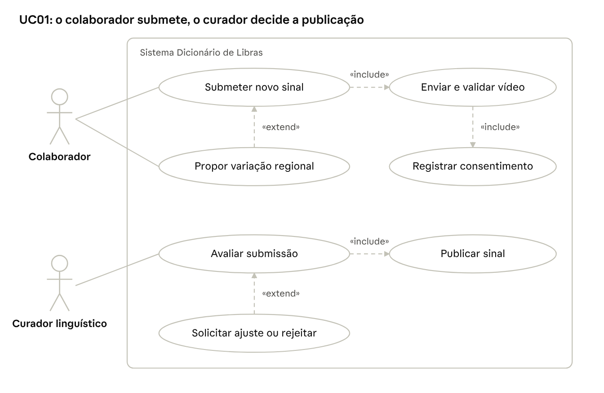

# Engenharia de Requisitos

> Original: [PDF](pdf/engenharia-de-requisitos.pdf)

## Sumário
1. [Visão geral](#1-visão-geral)
2. [Tipos de usuário](#2-tipos-de-usuário)
3. [Histórias de usuário](#3-histórias-de-usuário)
4. [Requisitos funcionais](#4-requisitos-funcionais)
5. [Requisitos não-funcionais](#5-requisitos-não-funcionais)
6. [Acessibilidade (WCAG 2.2 AA)](#6-acessibilidade-wcag-22-aa)
7. [LGPD](#7-lgpd)
8. [Caso de uso UC01](#8-caso-de-uso-uc01--submeter-e-aprovar-novo-sinal-com-vídeo)

## 1. Visão geral
O sistema expande o Dicionário de Libras do INES para permitir criar, alterar e excluir todos os campos de um
verbete, registrar variações regionais de um mesmo sinal (ex.: "Pai" no padrão nacional, no RJ e no RS) e enviar
o vídeo do sinal. Toda contribuição passa por um curador antes de ser publicada.

## 2. Tipos de usuário

| Perfil | O que faz |
|---|---|
| Visitante | Consulta o dicionário sem login: busca, filtra por região e assiste vídeos |
| Colaborador | Usuário cadastrado que envia novos sinais, variações e correções |
| Curador linguístico | Especialista em Libras indicado pelo INES; aprova, pede ajuste ou rejeita submissões |
| Administrador | Gerencia usuários, tabelas de apoio (assuntos, regiões, configurações de mão) e pedidos LGPD |

## 3. Histórias de usuário

| Perfil | História |
|---|---|
| Visitante | Quero buscar uma palavra e ver todos os seus sinais, para aprender o sinal certo. |
| Visitante | Quero filtrar sinais por região, para aprender o sinal usado onde moro. |
| Colaborador | Quero enviar um novo sinal com vídeo, para incluir um termo que falta no dicionário. |
| Colaborador | Quero propor uma variação regional de um sinal existente, para registrar o uso da minha comunidade. |
| Colaborador | Quero acompanhar o status das minhas submissões, para saber se preciso corrigir algo. |
| Curador | Quero uma fila de submissões pendentes, para revisar o que chegou. |
| Curador | Quero aprovar, pedir ajuste ou rejeitar com justificativa, para garantir a qualidade linguística. |
| Administrador | Quero gerenciar perfis e tabelas de apoio, para manter o sistema padronizado. |

## 4. Requisitos funcionais

| ID | Requisito | Prioridade |
|---|---|---|
| RF01 | Buscar por palavra, exemplo, acepção e assunto, e navegar por ordem alfabética, assunto e configuração de mão | Alta |
| RF02 | Inserir, alterar e excluir todos os campos do verbete (palavra, assunto, acepção, exemplos, classe gramatical, origem, imagem) | Alta |
| RF03 | Permitir vários sinais por verbete: um padrão (nacional) e variações ligadas a uma região | Alta |
| RF04 | Enviar vídeo do sinal (MP4/WebM, até 50 MB e 30 s) | Alta |
| RF05 | Toda contribuição de colaborador fica "Em análise" e só é publicada após aprovação | Alta |
| RF06 | Curador aprova, pede ajuste ou rejeita; ajuste e rejeição exigem justificativa | Alta |
| RF07 | Registrar consentimento do sinalizante no envio do vídeo | Alta |
| RF08 | Notificar o colaborador por e-mail quando o status da submissão mudar | Média |
| RF09 | Manter histórico de versões do verbete | Média |
| RF10 | Gerenciar usuários, perfis e tabelas de apoio | Alta |

### Diferenciais
Além do que o dicionário original oferece, o sistema traz quatro recursos voltados a quem aprende e a quem contribui.

| ID | Diferencial | O que resolve |
|---|---|---|
| RF11 | **Busca pelos parâmetros da Libras:** filtrar por configuração de mão, ponto de articulação (rosto, peito, mão), movimento e expressão facial | Encontrar um sinal visto sem saber a palavra em português |
| RF12 | **Mapa de variações regionais:** mapa do Brasil em que, ao clicar no estado, aparece o sinal usado ali | Torna a variação linguística visível e fácil de comparar |
| RF13 | **Gravação direto pelo navegador:** gravar pela webcam com moldura guiando o enquadramento de mãos e rosto e corte automático para até 30 s | Menos vídeos rejeitados por qualidade e envio sem precisar de outro app |
| RF14 | **Player feito para aprender Libras:** velocidade 0,5x e 0,75x, loop, avanço quadro a quadro e botão de espelhar para canhotos | Facilita entender e reproduzir o movimento do sinal |

## 5. Requisitos não-funcionais

| ID | Requisito | Métrica |
|---|---|---|
| RNF01 | Desempenho da busca | Resposta em até 1 s com 50 usuários simultâneos (teste de carga) |
| RNF02 | Carregamento do vídeo | Começa a tocar em até 2 s numa conexão de 10 Mbps |
| RNF03 | Acessibilidade | WCAG 2.2 nível AA; nota ≥ 95 no Lighthouse |
| RNF04 | Usabilidade | 90% dos testadores enviam um sinal sem ajuda em até 5 min |
| RNF05 | Segurança | HTTPS em tudo, senhas com hash e 0 falhas críticas no OWASP ZAP |
| RNF06 | Disponibilidade | 99,5% de uptime mensal |
| RNF07 | Manutenibilidade | Cobertura de testes ≥ 70% nas regras de negócio |

## 6. Acessibilidade (WCAG 2.2 AA)
Como o público principal é surdo, o sistema não depende de áudio e prioriza conteúdo visual e texto simples.
Pontos principais:

- texto alternativo em imagens e configurações de mão;
- descrição textual ao lado de cada vídeo;
- contraste mínimo de 4,5:1;
- navegação completa por teclado com foco visível;
- mensagens de erro que dizem como corrigir (ex.: "o vídeo tem 45 s; o limite é 30 s").

**Verificação:** axe DevTools, Lighthouse e teste manual com leitor de tela.

## 7. LGPD
O dado mais sensível é o vídeo do sinal, porque mostra rosto e expressões faciais e identifica a pessoa.
Vídeos de menores de 18 anos seguem o art. 14 da LGPD e exigem consentimento de pai, mãe ou responsável.

| Dado | Classificação | Base legal |
|---|---|---|
| Vídeo do sinalizante | Pessoal, tratado como sensível | Consentimento específico |
| Vídeo de menor de 18 anos | Dado de criança/adolescente | Consentimento do responsável legal |
| Nome, e-mail e senha | Pessoal | Execução do serviço |
| Logs de acesso | Pessoal | Legítimo interesse (segurança) |

**Consentimento:** o vídeo só é aceito após o aceite do termo de uso de imagem, registrado com data, versão do
termo e quem consentiu. O titular pode revogar a qualquer momento.

**Descarte:**

| Situação | Política |
|---|---|
| Submissão rejeitada | Vídeo apagado em 30 dias |
| Consentimento revogado | Vídeo sai do ar em 24 h e é excluído em até 15 dias |
| Logs de acesso | Mantidos por 6 meses |

## 8. Caso de uso: UC01 – Submeter e aprovar novo sinal com vídeo

| Campo | Descrição |
|---|---|
| Atores | Colaborador e Curador |
| Pré-condição | Colaborador logado |
| Pós-condição | Sinal publicado e visível na busca |

### Fluxo principal
1. O colaborador escolhe "Enviar novo sinal" e informa a palavra.
2. Preenche os campos do verbete, a região (ou nacional) e envia o vídeo.
3. O sistema valida o vídeo e exibe o termo de consentimento, que o colaborador aceita.
4. O sistema cria a submissão com status "Em análise".
5. O curador abre a submissão na fila, assiste o vídeo e compara com os sinais existentes.
6. O curador aprova; o sistema publica o sinal e notifica o colaborador.

### Fluxos alternativos
- **Palavra já existe (passo 1):** o sistema sugere enviar como variação regional do verbete existente.
- **Ajuste ou rejeição (passo 6):** o curador escreve a justificativa; o colaborador é notificado e pode corrigir e reenviar.
- **Vídeo inválido (passo 3):** o sistema informa o motivo e mantém os dados preenchidos.
