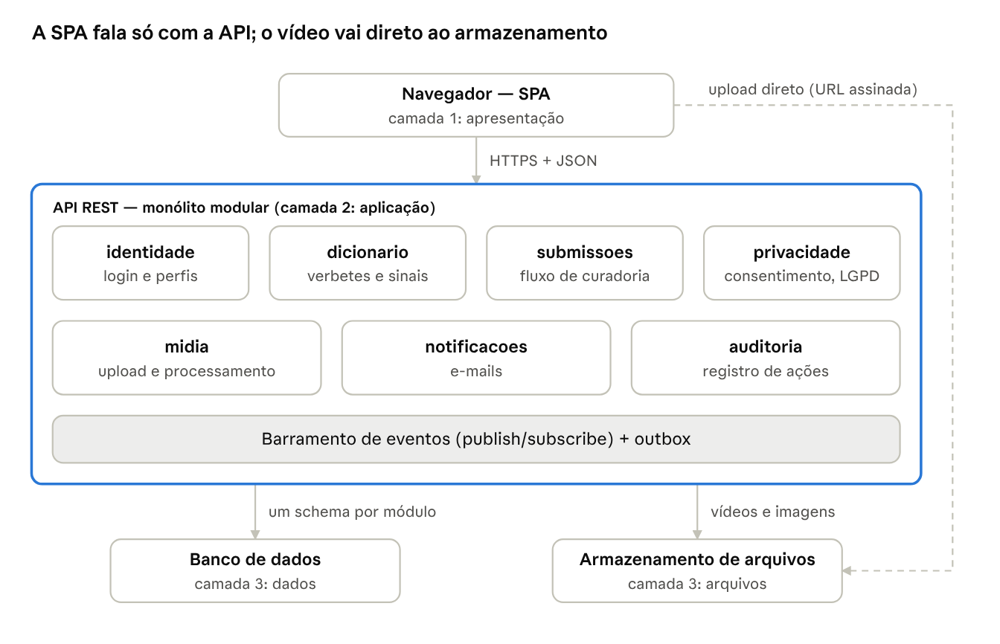

# Proposta de Arquitetura

> Original: [PDF](pdf/proposta-de-arquitetura.pdf)

## 1. Visão geral
O sistema usa **três camadas** com frontend e backend separados. O frontend é uma **SPA** simples, organizada por
páginas. O backend é um **monólito modular**: roda como um único processo, mas é dividido em módulos independentes,
cada um dono das suas regras e dos seus dados.

## 2. Justificativa
- **Microsserviços seriam complexos demais agora.** Para uma equipe pequena e um sistema desse tamanho, o custo de
  rede, deploy e transações distribuídas não compensa. Seguimos a recomendação de começar com um monólito.
- **Módulos isolados evitam o monólito bagunçado.** Um módulo só usa outro pela interface pública dele e nunca
  acessa tabelas alheias. Assim o sistema cresce sem virar um bloco único difícil de manter.
- **Eventos desacoplam os módulos.** Quando uma submissão é aprovada, um evento avisa os interessados (publicar o
  sinal, processar o vídeo, notificar e auditar), sem um módulo chamar todos os outros.
- **A SPA deixa a interface responsiva.** Player, gravação pela webcam e mapa funcionam sem recarregar a página, e a
  mesma API pode atender um app móvel no futuro.
- **Pronto para crescer aos poucos.** Se o processamento de vídeo virar gargalo, o módulo de mídia é extraído como
  microsserviço sem reescrever o resto, porque já funciona por eventos e com dados próprios.

## 3. Módulos do backend

| Módulo | Responsabilidade |
|---|---|
| `identidade` | Cadastro, login e perfis |
| `dicionario` | Verbetes, sinais, variações regionais e busca |
| `submissoes` | Envio de contribuições e curadoria |
| `midia` | Upload, validação e processamento de vídeo |
| `privacidade` | Consentimento e descarte de dados (LGPD) |
| `notificacoes` | E-mails ao usuário |
| `auditoria` | Registro das ações |

Cada módulo tem as mesmas camadas internas:

| Camada | Conteúdo |
|---|---|
| `http` | Rotas |
| `aplicacao` | Casos de uso |
| `dominio` | Regras de negócio |
| `infra` | Banco e arquivos |

## 4. Frontend
SPA organizada por páginas — busca, verbete, enviar sinal, minhas submissões, curadoria e administração — com
alguns componentes compartilhados: player, gravador de webcam, mapa de variações e busca por parâmetros.
Toda comunicação com o backend passa por um único serviço de API.
